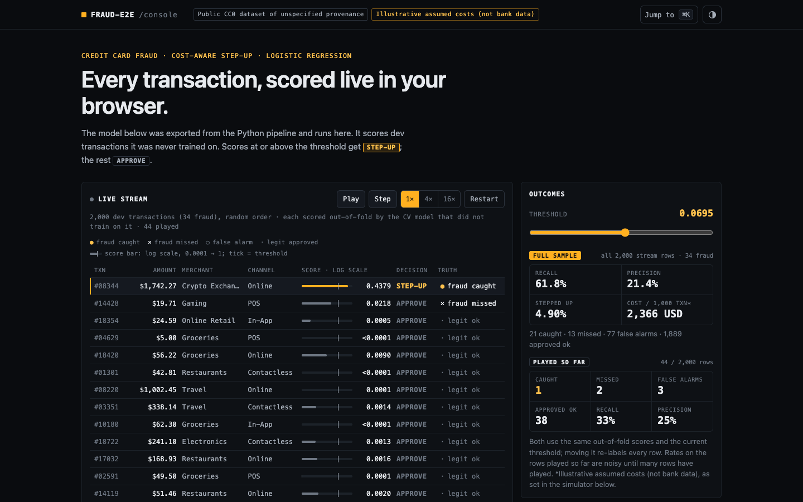

# Fraud-E2E: cost-aware credit card fraud detection

[](https://github.com/Natpaphonnn/fraud-console/actions/workflows/ci.yml)

An end-to-end data-science case study on a small, highly imbalanced fraud dataset: data checks, EDA, pre-registered model comparison, expected-cost thresholds, a one-time holdout check and explanations — with an uncertainty interval on every number.

**Links:** Project page (with threshold simulator): [Project page](https://natpaphonnn.github.io/fraud-console/) · Kaggle notebooks: [Kaggle notebooks](https://www.kaggle.com/code/natpaphonnukhunthod/fraud-why-logistic-beats-lightgbm-smote-hurts) · Medium article: _coming soon_

> **Status:** data-science work complete (notebooks 00–06, model card) and a static "fraud console" project page (`web/site/`): the logistic model runs in the browser on a live stream of dev transactions, with per-feature contributions, a build-your-own transaction form and a cost/threshold simulator. A small scoring API (FastAPI, Docker, CI) serves the same model; MLflow and drift monitoring are deferred.



## The problem

A card issuer scores every transaction for fraud. Transactions above a threshold are sent to **step-up** (review or extra authentication such as OTP / 3-D Secure); the rest are approved. Two mistakes cost money in different ways: stepping up a good customer (friction) and missing a fraud (the amount is lost). The goal is a model that ranks fraud well **and** a threshold that minimises total expected cost.

## Key results

<!-- generated by scripts/render_docs.py from reports/*.json; do not edit numbers by hand -->

Final model: **logistic regression**. Fraud is 1.70% of transactions, so a random score has PR-AUC ≈ 0.0169.

| Metric | CV on dev (15 folds, mean [95% CI]) | Holdout, scored once (68 fraud; bootstrap 95% CI) |
|---|---|---|
| PR-AUC (primary) | 0.415 [0.341, 0.490] | 0.468 [0.361, 0.585] |
| ROC-AUC | 0.942 [0.928, 0.957] | 0.950 [0.923, 0.972] |
| Recall at step-up threshold 0.0695 | 69.5% | 70.6% [60.3%, 80.9%] |
| Precision at that threshold | 23.5% | 23.8% [20.0%, 27.8%] |
| Share of transactions stepped up | 5.01% | 5.05% [4.45%, 5.67%] |
| Cost saving vs stepping up nobody* | 47.6% | 37.0% [13.2%, 63.4%] (post-hoc, descriptive) |

\* **Illustrative assumed costs (not bank data).** Step-up 5 USD, extra friction for a good customer 10 USD, missed fraud = amount + 15 USD. The threshold was chosen on dev out-of-fold predictions only.

**What we learned**

- **Logistic regression beat gradient boosting on this dataset.** Best boosting pipeline (`lgbm_tuned`) minus logistic: PR-AUC -0.048 [-0.084, -0.012]. Fraud odds multiply with each extra red flag (×7.6, ×5.7, ×4.9, ×3.2 going from 0→1, 1→2, 2→3 and 3→4+ flags), roughly the additive log-odds shape a logistic model captures directly; tuning pushed LightGBM towards very small trees and it still did not catch up. This is a statement about this data, not about fraud models in general.
- **SMOTE made things worse** (PR-AUC -0.177 [-0.229, -0.125] vs no resampling). SMOTENC sets categorical/boolean features by neighbour majority vote, so synthetic fraud carried red flags only 0.38× as often as real fraud. Class weights (-0.023 [-0.058, +0.013]) and undersampling (-0.005 [-0.036, +0.026]) did not help either.
- **A decline tier did not clearly pay off.** Approve / step-up / decline looked cheaper on CV (-104 USD per 1,000 transactions) but on the holdout the difference was -21 USD [-103, +60].
- **Fairness by age: No gap passes the pre-registered rule.** Step-up rate, recall, precision and false-positive rate per age band (16 comparisons, Bonferroni) are all **not distinguishable**, which is not evidence of fairness. At the unadjusted 95% level 4 gaps exclude 0 (older bands sit above the rest and younger bands below). Removing `customer_age` changes PR-AUC by -0.002 [-0.008, +0.005] (not distinguishable).
- **Splines and red-flag interactions did not help** (-0.016 [-0.041, +0.009] and +0.002 [-0.021, +0.024] vs logistic): the additive model is not visibly missing structure.
- **The threshold depends on the cost assumptions.** Scaling each cost ×0.5 or ×2 moves the best threshold between 0.0292 and 0.1334.

## Data

- *Credit Card Fraud Detection 2026* by Udit Jain, [Kaggle](https://www.kaggle.com/datasets/uditjain13/credit-card-fraud-detection-2026), licence **CC0 (public domain)**.
- A **public CC0 dataset of unspecified provenance**: the data card does not say whether rows are real or synthetic, so no result here is a claim about real-world card fraud.
- 20,000 transactions, 339 fraud, 24 features, no missing values.

**Limitations:** no customer or card ID (no customer-level features, no grouped split) · no real timestamp (no out-of-time validation) · few fraud cases (wide intervals) · illustrative costs. Full list: [model card](docs/model_card.md).

## Notebooks

| # | Notebook | Question |
|---|---|---|
| 00 | [Summary](notebooks/00_summary.ipynb) | The whole project on one page |
| 01 | [Data understanding](notebooks/01_data_understanding.ipynb) | Is the data fit for purpose? How do we split and price mistakes? |
| 02 | [EDA](notebooks/02_eda.ipynb) | Which features carry signal? Any leakage? |
| 03 | [Baseline](notebooks/03_baseline.ipynb) | How good is a simple logistic regression? |
| 04 | [Modelling](notebooks/04_modeling.ipynb) | Boosting, imbalance handling, tuning, calibration — what actually helps? |
| 05 | [Threshold and cost](notebooks/05_threshold_and_cost.ipynb) | Which threshold minimises cost? Does it hold on the holdout? |
| 06 | [Explainability](notebooks/06_explainability.ipynb) | What drives the score, overall and per transaction? |
| 08 | [Fairness by age](notebooks/08_fairness.ipynb) | Do age groups get different step-up, recall or false-alarm rates? Is age needed? |
| 09 | [Interactions / GAM](notebooks/09_interactions.ipynb) | Does logistic regression miss non-linear or interaction structure? |

Self-contained Kaggle editions of 01–06, 08 and 09 are in [`kaggle/`](kaggle/), plus a 10-minute story notebook that tells the whole project in one place ([`kaggle/fraud_story.ipynb`](kaggle/fraud_story.ipynb)).

## How the evaluation stays honest

- 20% stratified holdout locked before any label-based analysis, scored **once**; a lock file refuses any other pipeline or threshold.
- Repeated stratified 5-fold CV (3 repeats) on the other 80%; all preprocessing and resampling inside training folds; leakage guards in the test suite.
- Comparisons and decision rules written down before results ([pre-registration](notes/00_preregistration.md), with dated amendments): a more complex option replaces a simpler one only if the 95% CI of the paired difference (corrected resampled t-test) excludes 0.
- Every number in this README, the model card, notebook 00 and the project page is generated from committed artifacts in `reports/`.

## Run it

```bash
uv sync              # Python 3.12 environment from uv.lock
make check           # ruff + pytest (incl. leakage/split guards) + docs/website freshness + JS tests
make notebooks       # re-execute notebooks 00–06 in order; results land in reports/
make docs            # regenerate README.md, docs/model_card.md and web/site/ from reports/
make web-serve       # preview the project page at http://localhost:8000
make kaggle          # rebuild Kaggle editions
make content-preview # low-res previews of the 3-D content figures (full renders: Actions → Content figures)
```

The whole pipeline runs on a laptop in a few minutes (seed 42, deterministic).

## Scoring API

`api/` serves the same exported model as the website (`reports/p4_web_model.json`) with pure-Python scoring: `POST /predict` returns the fraud score, the decision at the project threshold (`approve` / `step-up`) and the three largest per-feature contributions (coefficient × model input, log-odds); `GET /health` reports the model id. Requests are validated with pydantic (types, ranges, known categories, no extra fields). Tests check that the API's score equals the Python pipeline's for all 2,000 transactions on the website (≤ 1e-9). The threshold comes from **illustrative assumed costs (not bank data)**.

```bash
# with uv (from the repo; model files are read from reports/)
uv sync
uv run uvicorn api.app:app --port 8000

# or with Docker (python:3.12-slim, non-root; built and smoke-tested in CI)
docker build -t fraud-console-api .
docker run --rm -p 8000:8000 fraud-console-api

# then, in another terminal (example_request.json is a real dev transaction)
curl -s localhost:8000/health
curl -s -X POST localhost:8000/predict -H 'Content-Type: application/json' -d @api/example_request.json
```

Interactive docs: <http://localhost:8000/docs>. CI (`.github/workflows/ci.yml`) runs lint, pytest, the Node tests, builds the image and calls `/predict` inside the container.

## Repository layout

```
src/fraud_e2e/   library code (data, splits, features, models, cv, cost, threshold, evaluate, explain, summary)
notebooks/       executed notebooks (sources in notebooks/py/)
kaggle/          Kaggle editions of the notebooks
reports/         JSON/CSV results, CV fold metrics, figures
docs/            model card, deploy guide (+ templates for generated docs)
web/             static project page: templates/ (source) → site/ (generated, deployable)
api/             FastAPI scoring service (+ Dockerfile, .dockerignore at the repo root)
.github/         CI (lint, tests, Docker smoke test), Pages deploy, content renders
notes/           pre-registration, cost assumptions, experiment log, holdout lock
configs/         cost assumptions, public links
tests/           pytest suite
```

## Licence and credits

- **Code:** MIT, see [LICENSE](LICENSE).
- **Data:** *Credit Card Fraud Detection 2026* by **Udit Jain**, [CC0 1.0](https://creativecommons.org/publicdomain/zero/1.0/) (public domain dedication by its author), committed unmodified with its source and hash in [`data/raw/SOURCE.md`](data/raw/SOURCE.md). The MIT licence does not apply to it.
